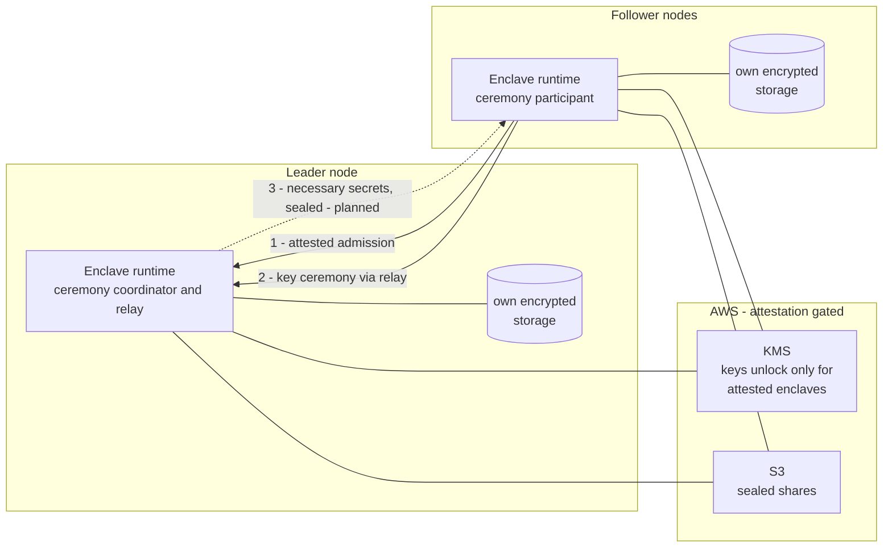
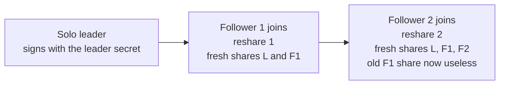
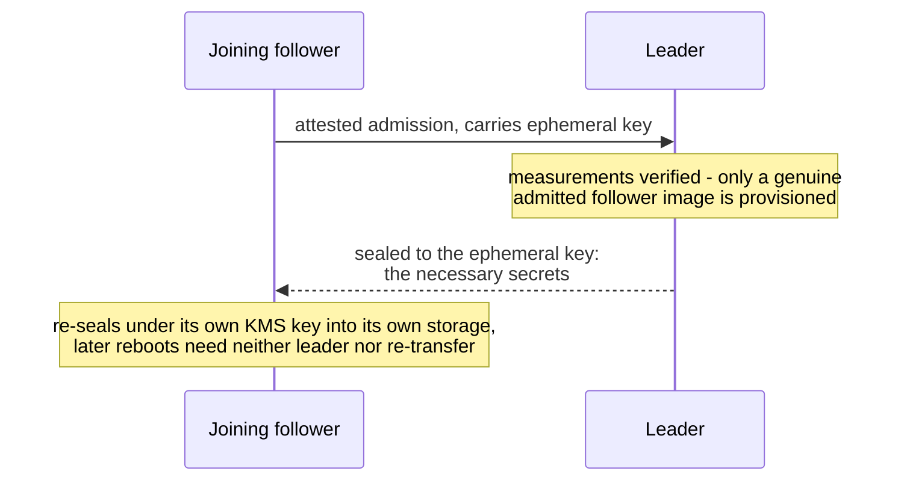

# Threshold Scaling Architecture

**Repository:** `ArkLabsHQ/enclave`, branch `dkg` · **Cryptography:** ChillDKG / FROST via
`ArkLabsHQ/threshold-magic` · **Status:** multi-node ceremony validated end-to-end in the
NixOS `scaling` check; signing integration and production hardening tracked in the roadmap (§8).

---

## 1. Executive Summary

This work introduces a **new scaling model for enclave applications, built on threshold
cryptography**. Instead of copying signing keys onto every machine, a cluster of
enclaves collectively *is* the key: each node holds only a **share**, producing a
signature requires a **quorum**, It makes use of a Leader/Follower system, where the Leader posseses the full secret. The public
key that applications depends on **never changes** as nodes join or leave.

**Key properties**

| Property | Meaning |
|---|---|
| Zero pre-shared trust | Nodes admit each other purely by hardware attestation — the leader admits only the follower images it was built with |
| Group key invariance | The group public key stays pinned to the original secret; membership changes are invisible externally |
| Proactive resharing | Every membership change re-randomizes **all** shares; captured old shares become useless |
| Opt-in per secret | Only secrets tagged `kind: signing` participate; single-node deployments are untouched |

---

## 2. How Threshold Scaling Works

The signing key never exists in one place: each node holds a **share**, and producing
a signature requires a **quorum** of nodes cooperating.

```
  +---------+     +---------+     +---------+
  | Leader  |     | Node F1 |     | Node F2 |
  | share L |     | share F1|     | share F2|
  +---------+     +---------+     +---------+
       \               |               /
        \______________|______________/
                       |
            quorum of shares => signature
       compromising one node yields < quorum
          group public key: never changes
```

Enabling it is a single field in the application's secret declaration:

```yaml
secrets:
  - name: app_key            # ordinary secret
    env_var: APP_KEY
  - name: signing_key        # threshold-scaled
    env_var: SIGNING_KEY
    kind: signing
```

---

## 3. System Overview

One node is designated **leader**; all others are **followers**. The leader and the
followers run **separate images** built from the same code, with the role baked in. Each
image has its own PCR0, and with it its own master seed and its own KMS key, which only
that PCR0 can use. The leader image is built with the PCR0s of the follower images it
admits. The leader address reaches a follower through its SSM overlay.




**Roles at a glance**

| | Leader | Follower |
|---|---|---|
| Holds | Leader secret (derived from its seed) + its own share | Its own share only |
| Runs | Admission endpoint + ceremony coordinator | Ceremony participant |
| Initiates | Nothing — pure responder | Admission, join, reshare requests |
| Pins | The group key to the original secret | — |

---

## 4. Trust Model & Admission

Before a follower may participate in any key ceremony, it must prove it is a **genuine
enclave running a follower image the leader was built to admit**. The follower always
initiates; the exchange is mutually attested and replay-proof:

```
Follower (initiator)                       Leader (responder)
   │                                          │
   │  1. request one-shot nonce               │
   │ ────────────────────────────────────────►│
   │ ◄────────────────────────────────────────│
   │      one-shot leader nonce (60s TTL)     │
   │                                          │
   │  2. admission request                    │
   │     attestation document:                │
   │       nonce      = leader's nonce        │
   │       user data  = {my nonce, my hostpub}│
   │       public key = my ephemeral box key  │
   │ ────────────────────────────────────────►│
   │              verify: hardware signature, PCR0 is an
   │              admitted follower image,
   │              nonce is one I issued (one-shot consume)
   │              authorize follower identity
   │ ◄────────────────────────────────────────│
   │     leader's attestation document:       │
   │       nonce     = follower's nonce       │
   │       user data = sealed to ephemeral key│
   │                   {leaderPub, relayPort} │
   │                                          │
   │  verify leader PCR1 (kernel) == mine,    │
   │  nonce echoed, unseal payload            │
   │                                          │
   │  3. join ceremony via relay → reshare    │
   │ ────────────────────────────────────────►│
```

**Security properties**

- **Mutual, unequally** — the leader admits only the follower PCR0s it was built with.
  The follower cannot pin the leader image (the leader is built after it), so it checks
  only that the leader is a genuine enclave on the same kernel (PCR1). A fake leader
  could waste a follower's time but never learns a leader secret or a real share.
- **Image-scoped identity** — only PCR0 is compared; host-specific values are excluded
  so the same follower image is admitted from any machine.
- **Replay-proof** — nonces are single-use with a short TTL.
- **Confidential** — the leader's response payload is sealed to an **ephemeral key the
  follower generated for this handshake**, inside the signed attestation. This sealed
  channel is also the planned vehicle for cluster provisioning — see roadmap item 2.
- **Defense in depth** — an admitted identity is additionally enforced at the ceremony
  protocol layer; unadmitted participants are rejected by the relay itself.

---

## 5. Key Lifecycle

### 5.1 Membership changes re-randomize everything

Every join triggers a **reshare over the same underlying secret**. Shares change;
the group public key does not.



- **Every ceremony is per secret.** Each secret tagged `kind: signing` forms its own
  independent group: ceremonies are labeled by the secret's env var, and the label
  routes every delivered share back to the right secret. Two tagged secrets mean two
  independent share sets and two group keys.
- **Followers never need to know each other in advance.** The leader is the single
  source of membership truth: every admitted node's identity key sits in the leader's
  in-memory committee, and each ceremony begins with the leader broadcasting the **full
  member roster** (each participant's id and host public key) in a signed,
  epoch-numbered start command. A follower builds its view of the group *entirely* from
  that command — it never exchanges keys with peers directly. It accepts the command
  only under the leader key it pinned during the attested handshake; the epoch blocks
  replays; and the ceremony's final round has every participant sign the same session
  transcript (which includes the roster), so if any two nodes were fed different
  rosters the ceremony fails rather than silently forking.
- The group public key is **identical** at every stage — pinned to the original secret,
  which only the leader holds. The leader derives it from its own seed like any static
  secret, so it is never stored and migration preserves it.
- Shares are delivered **live** while the node runs — the full path is §5.2.
- Persistence is a per-node **sealed share** (§5.3). Membership itself is *not*
  persisted: the committee lives only in the running leader, so a rebooted follower
  simply re-runs admission (its host identity key derives from its seed, so it re-admits
  as the same identity) and the next reshare folds it back in.

### 5.2 From ceremony to running application

Ceremony results arrive **asynchronously**. Both protocol engines — the leader's and
the follower's — expose their output as a **`Keys()` channel**: whenever a ceremony
completes for a `kind: signing` secret, the engine emits that node's freshly derived
**secret share** on the channel, together with the group public key and the **label**
(the secret's env var) that ties the result back to the secret it belongs to. This is
the *only* way share material ever leaves the ceremony engine.

On every node — leader included, since the leader is a full participant in its own
ceremonies — a dedicated background **listener goroutine drains `Keys()`** for the
lifetime of the process. Each delivery runs the same pipeline:

```
   ceremony completes  (per secret, labeled by its env var)
          │
          ▼
   listener goroutine receives { label, share, group key }
          │
          ▼
   persist sealed share             the share becomes the app's
   (reboot skips the ceremony)      value for ENV[label], replacing
          │                          the leader secret
          ▼
   signal the app supervisor
          │
          ▼
   graceful stop of the app  (SIGTERM, 10s grace, then kill)
          │
          ▼
   fresh app process forked
   → its environment carries the new share
   → signs with the re-randomized share
```

Two details make this safe:

- **The app's env var always holds what the node signs with *now*** — the share once a
  group exists; on a solo leader, before any follower joins, it is the leader secret
  itself. From the first reshare onward the leader secret leaves the app's environment
  for good and stays only in the runtime's memory.
- **The application is restarted.** A running process only reads its environment at
  startup, so after each reshare the runtime gracefully replaces the upstream app; the
  new process boots with the fresh share already in place. Shares delivered during boot
  are part of the first launch, and the runtime itself never restarts — only the
  application child.

### 5.3 At rest — the sealed share

Each signing secret persists as **one object per node** in the certificate bucket,
under the node's own `<namespace>/<app>/data/threshold/`: its current share and the
group key, sealed with the storage key derived from the node's seed. The leader secret
is never stored; the leader derives it again on every boot.

- **On boot** the node opens its share inside the enclave and gives it to the app, so a
  reboot never re-runs a ceremony. A follower without one requests a reshare and waits
  for it before starting the app.
- **On every reshare** the object is rewritten with the fresh share.
- **Migration** preserves the seed, and with it the storage key, the leader secret and
  the group key.

---

## 6. Cluster Data Model

A hard constraint shapes everything here:

> **Followers must never be able to reach the leader secret.** The leader runs its own
> image, so its seed sits under a KMS key only the leader's PCR0 can use: attestation,
> not IAM, enforces leader exclusivity. Replicas of one image share its seed, so each
> image runs as one node per AWS account.

Every enclave is otherwise **self-contained**: each node runs its **own encrypted
storage** — nodes never share a datastore, and nothing here changes that. What this
work splits is the **signing key**; the only data that ever crosses between nodes is
what the protocol itself requires, passed over the sealed, attested channel. The data
therefore falls into these access classes:

| Data | Access class | Today (test topology) |
|---|---|---|
| Leader secret | **Leader only** | ✅ isolated |
| Each node's share + identity key | **That node only** | ✅ isolated |
| Sealed shares, recovery data, ban list | **That node only** — sealed with its own storage key | ✅ isolated |
| Necessary secrets a joiner needs | **Passed node-to-node, sealed** | ❌ provisioning path not built yet |


---

## 7. Validation

A full **1 leader + 2 follower** cluster runs in CI on emulated Nitro hardware
(QEMU + KVM) as the NixOS `scaling` check, booting a leader image and two follower
images (one per agency). The suite asserts:

1. All three nodes healthy; only the leader serves admission.
2. Admission completes; a solo leader's app holds the leader secret.
3. Every node — leader included — ends up holding a **share**, not the leader secret.
4. The second join **re-randomizes** the first follower's share (proactive resharing
   observed, not assumed).
5. All three shares are distinct, valid scalars.
6. A silent follower is evicted, and the survivors reshare without it.

Single-node deployments run the pre-existing integration suite unchanged — threshold
scaling is fully opt-in.

---

## 8. Roadmap

**1 · Signing key package.** A share alone is not enough to sign: each node — **leader
and followers alike** — also needs a small amount of signing context. The extras are
minimal: its **participant identifier**, the **group public key**, and the current
**threshold** (derivable from membership size by the quorum policy). Per-participant
verification shares are *not* required: signing never uses them, and correctness is
guaranteed by verifying the final aggregate signature against the invariant group key
— while the attested admission already authenticates every participant, so per-share
checks would add only blame attribution, not soundness. The ceremony already computes
all of this; today it is discarded en route. Plan: surface it from the SDK, persist it
in each node's sealed envelope (rewritten on every reshare, since identifiers and
threshold change), and deliver it to the application alongside the share. A
signing-session coordination layer (nonce exchange, share aggregation) follows on top.

**2 · Provisioning necessary secrets over the attested channel.** Joining the cluster
is more than receiving a share: a new node must also be provisioned with the secrets
it needs to serve traffic — **without ever gaining access to the leader secret**
(§6). The admission handshake already establishes exactly the channel needed: the
follower presents an **ephemeral encryption key inside its attestation document**, and
the leader can seal data to it. Provisioning becomes a natural step of the join flow —
storage stays strictly per-enclave; the joiner writes what it receives into its **own**
sealed storage:



The follower re-wraps the received material under its own attestation-gated KMS key
and keeps it in its own namespace, so the transfer happens once per node, not per
boot, and no node ever reads another node's storage or parameters. Open point:
first-boot ordering — a joining node needs the leader reachable once.

**3 · Attestation binding of the group key.** Done: a signing secret's PCR(16+i)
commits to the invariant **group** public key, not the volatile share, so every member
attests the same value.

**4 · Membership revocation.** Resharing currently triggers on *join* only. Removing a
node needs a leave-triggered reshare and revocation of its admission, so a
decommissioned node's share is invalidated immediately rather than at the next join.

---

